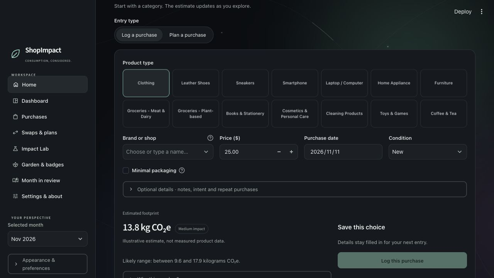
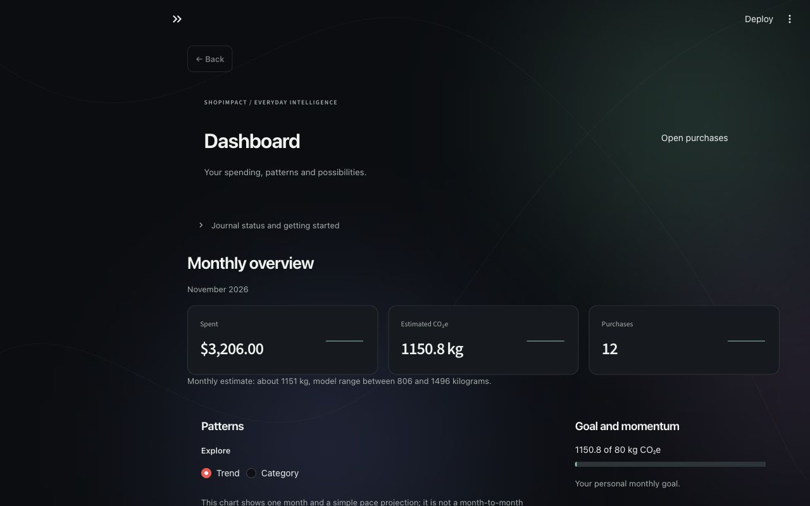

<p align="center">
  
</p>

<p align="center"><strong>A personal purchase journal to track spending, explore estimated footprints and compare choices.</strong></p>

<h3 align="center">
  <a href="https://shopimpact-app.streamlit.app/">🌐 Live Demo</a> &nbsp;·&nbsp;
  <a href="https://canva.link/v49hfof5yt02eqe">🎞️ Presentation</a> &nbsp;·&nbsp;
  <a href="#14-installation">🚀 Get Started</a> &nbsp;·&nbsp;
  <a href="#5-the-everyday-workspace">✨ Features</a>
</h3>

- **Log purchases:** record prices, dates and condition; edit, import or export your journal.
- **Understand patterns:** view monthly spending, category breakdowns and estimated footprints.
- **Explore choices:** compare alternatives, plan purchases and ask Tilly for explanations.
- **Make it yours:** Light and Dark modes, a growing garden and optional accounts or guest entry.

<details>
<summary><strong>App screenshots — purchase entry and dashboard</strong></summary>

<p align="center">
  
  
</p>

Screenshots show the app interface. Dashboard records are simulated test inputs; estimates are illustrative, not measured emissions.

</details>

**Run locally:** from the repository root, run `python -m pip install -r requirements.txt`, then `python -m streamlit run app.py`. Keep the full repository, including `core/`, alongside the entry file. Guest mode works without API keys.

Research methods, data sources and validation are documented in [Research tools](#6-research-tools). [Clean-install check](docs/DEPLOYMENT.md).

---

## 1. Introduction

ShopImpact helps people record purchases, understand their patterns and explore alternatives before their next decision. A monthly dashboard, a purchase journal, planning tools and a playful garden make the app useful beyond a single estimate.

For a closer look at the evidence, **Impact Lab** opens a research toolkit with cited factors, reproducible simulations, manufacturer comparisons and a constrained optimizer. **Ask Tilly**, the app's turtle assistant, explains the methods and supplied results through Groq.

The app keeps the everyday experience at its centre: eight familiar pages, Light and Dark modes, subtle blue-and-green ambient animation, Tilly, a growing plant and a footprint trail. Research and AI extend that workspace.

## 2. Problem statement

A purchase price is easy to record. Its environmental impact is harder to interpret.

A spend-based model can assign a lower estimate to a cheaper product even when the underlying product design or expected service life has not improved. Category averages also hide differences between individual products. An attractive number can therefore appear more certain than the evidence supports.

ShopImpact makes those assumptions inspectable. It combines a practical journal with tools that ask where estimates come from, how mapping choices affect them and when a different method gives a different answer.

## 3. Objectives

- Make purchase recording, planning and reflection straightforward.
- Keep model assumptions and data provenance visible.
- Investigate disagreement between spend-based estimates and product-level life-cycle assessments.
- Demonstrate a non-trivial optimization algorithm with a reproducible counterexample.
- Give AI a bounded explanatory role, with consent and minimal shared context.
- Support repeatable experiments, data exports and independent evaluation.

## 4. Target users

- People exploring their spending and consumption patterns.
- Students learning about environmental estimation, data science and AI.
- Researchers or educators using a small, inspectable prototype to discuss model limitations.

The app does not establish a user's complete carbon footprint, verify brand sustainability or replace a product-specific life-cycle assessment.

## 5. The everyday workspace

### Home

Log a purchase or plan one, choose a category, enter a price and date, and inspect the live illustrative estimate. Optional notes, intent tags, condition and packaging fields preserve context. Quick-add entries help with repeated purchases.

The monthly snapshot brings together spending, purchase count, estimated impact and a personal goal. Tilly, the growing plant and footprint trail provide playful feedback alongside those numbers.

### Dashboard

Explore category breakdowns, spending, monthly trends, goal progress and deterministic insights. Chart styling follows the selected appearance.

### Purchases

Search and filter the journal, edit or remove entries, undo changes, manage recurring purchases, and import or export CSV data.

### Swaps and plan

Compare illustrative alternatives and keep track of planned, bought, swapped or skipped decisions. Modelled differences remain hypothetical; they do not establish actual emissions savings.

### Impact Lab

Use the original action planner, inspect the illustrative model and review journal coverage. Open **Research tools** for cited estimates, validation, exact budget planning and experiment replay. Ask Tilly and the study feedback form are also available here.

### Garden and badges

Meet the renewed turtle Tilly, explore the Turtle-generated garden, plant and footprint illustrations, and revisit badges, XP, streaks and optional challenges. Badges use distinct vector emblems and responsive card rows.

These rewards reflect recorded activity and model rules, not independently verified environmental outcomes.

### Month in review

Review a monthly narrative, add reflection notes and export summaries, including Markdown, image and PDF snapshots.

### Settings and about

Choose appearance, currency display, goal and accessibility preferences. Download backups, preview a restore and inspect the everyday model's limitations and storage behaviour.

### Account access

Every fresh session opens the minimal account screen. Choose **Log in**, **Sign up**, or **Continue as guest** before accessing any feature. Direct feature links also require this choice, then resume the requested page. Guest admission lasts only for the current session. New accounts require a password of at least 12 characters and email confirmation. While signed in, open **Your account → Log out** to end the session and return to the entry screen. Expired sessions that cannot refresh also return there.

Supabase manages authentication, and a dedicated SMTP2GO connection sends confirmation emails. Password forms clear after submission; access and refresh tokens stay in the Streamlit session rather than the saved journal. An actual signup confirmation reached the maintainer on **12 November 2026**.

Accounts currently authenticate identity only. **Journals remain browser-local: they do not sync across devices or become private by account.** Other users of a shared browser can still access its local journal. Guest access keeps the everyday tools available without an account. See [account setup and privacy](docs/ACCOUNTS.md).

## 6. Research tools

Research lives inside **Impact Lab → Open research tools** and shares the app's sidebar, appearance, motion preference and selected month.

- **Cited estimates:** EPA spend-based estimates with source-factor snapshots, CPI normalization and purchase-level simulation histograms.
- **Research journal:** versioned research records, source inspection, removal/undo and validated JSON backup/restore.
- **Monthly analysis:** shared-factor Monte Carlo totals, category error bars, a personal budget forecast, concentration analysis and outlier flags.
- **Method:** source versions, category mappings, boundaries, assumptions and regional availability.
- **Validation:** manufacturer-reference comparisons, signed mismatches and a downloadable pilot-results table.
- **Budget planner:** exact dynamic programming versus greedy selection, budget/change/feasibility constraints and a cost–CO₂ scenario frontier.
- **Product text:** a local classifier with an uncalibrated score, manual corrections and inspectable precision/recall results.
- **Lifespan:** emissions allocation per year, cost per use and keep-versus-replace break-even exploration.
- **Replay:** import a seeded experiment JSON and check that the pinned dataset reproduces its recorded result.
- **Feedback and export:** consent-based ratings, a downloadable response and an opt-in research export.

### The research question

**When does spend-based estimation disagree with product-level LCA?**

The initial pilot compares published US base-configuration prices and manufacturer LCA totals for three Apple products:

- **iPhone 15 128GB:** approximately **85.18 kg CO₂e** from the spend model versus **56 kg** in the manufacturer reference.
- **iPhone 15 Plus 128GB:** approximately **95.84 kg** versus **61 kg**.
- **MacBook Air M2 256GB (2022):** approximately **69.54 kg** versus **147 kg**.

The spend model is above both phone references and below the laptop reference in this sample. This is a descriptive finding from **three configurations, one manufacturer and convenience selection**. EPA upstream supply-chain accounting and manufacturer full-life-cycle LCAs also have different boundaries. The mismatch cannot be read as a clean accuracy score or generalized to all purchases.

### Why the optimizer is more than a ranking

The research planner solves a grouped knapsack problem: at most one action per purchase group, a hard budget, a maximum number of changes and a feasibility filter. Costs use integer minor units. Benefits are explicit user-supplied scenarios.

A simple counterexample shows why benefit-per-cost greedy selection can fail:

- Action A costs 6 units and offers 12 units of hypothetical benefit.
- Actions B and C each cost 5 and offer 9.
- With a budget of 10, ratio-greedy chooses A for a benefit of 12.
- Exact dynamic programming chooses B + C for a benefit of 18.

The app exposes this example, the recurrence and the nondominated frontier. Tests compare the exact solution with exhaustive enumeration on small instances.

## 7. Technology stack

- **Python and Streamlit:** application, forms, navigation, chat and session state.
- **Pandas and Altair:** journal analysis, data tables and interactive charts.
- **Python Turtle and SVG:** code-generated plant, footprint and garden illustrations.
- **Custom SVG/CSS:** Tilly, badge icons, themes, ambient effects and reduced-motion behaviour.
- **Groq API:** Ask Tilly, currently configured with `openai/gpt-oss-120b`.
- **Supabase Auth and SMTP2GO:** optional email/password accounts, confirmation emails and logout.
- **Standard-library HTTP:** provider requests, authentication headers, bounded responses and timeouts.
- **shopimpact-core:** locally installable, dependency-free research calculations and CLI.
- **Pytest, Hypothesis, Ruff, Playwright and axe:** verification tools and browser/accessibility checks.

The app is tested locally with Python 3.14. The core package declares Python 3.11 or newer; that does not establish compatibility of every pinned app dependency with every Python release.

## 8. System architecture

```text
Browser
  └─ Streamlit app.py
       ├─ Everyday workspace: views/ + ui/
       │    ├─ Journal and model: logic.py + data_io.py
       │    ├─ Plans, badges and review exports
       │    └─ Browser-local persistence
       ├─ Impact Lab → research_workspace.py
       │    └─ research_app.py → shopimpact-core
       │         ├─ Pinned EPA / CPI / manufacturer data
       │         ├─ Simulation, validation and optimization
       │         └─ Reproducible research journal / exports
       ├─ Account access → views/account.py + ui/account.py
       │    └─ account_auth.py → Supabase Auth → SMTP2GO confirmation email
       └─ Ask Tilly → ask_tilly.py
            ├─ Explicit consent and context preview
            ├─ Optional aggregate month summary
            └─ Groq API → explanatory response
```

```text
ShopImpact/
├── app.py                       # Main router; original eight-page workspace
├── ask_tilly.py                 # Grounded chat adapter and request guards
├── account_auth.py              # Managed email authentication and safe provider errors
├── research_workspace.py        # Research integration inside the app
├── research_app.py              # Research tool renderers and storage validation
├── logic.py                     # Everyday illustrative model and journal helpers
├── gamification.py              # XP, streaks and playful progress
├── data_io.py                   # Journal interchange
├── plan_tools.py                # Everyday planning workflow
├── impact_lab.py                # Original illustrative experiments
├── browser_storage.py           # Browser storage bridge
├── browser_persistence.py       # Saved-state validation and encoding
├── charts.py                    # Everyday charts
├── summary_image.py             # Monthly export rendering
├── tilly_svg.py                 # Renewed turtle mascot
├── turtle_svg.py                 # Turtle-generated SVG drawings
├── studio.css                   # Shared two-mode visual system
├── styles.py                    # Theme variables and chart styling
├── views/                       # Pages, embedded research and Ask Tilly
├── ui/                          # Shared state, components, illustrations and undo
├── core/                        # shopimpact-core package, CLI, data and tests
├── data/sources/                 # Source-data snapshot
├── docs/shopimpact-banner.svg   # Custom README banner
├── static/                      # Local fonts and identity assets
├── tests/                       # Python and active browser checks
├── docs/                        # Method, setup and development documentation
├── .github/                     # CI workflow and public feedback issue form
├── .streamlit/config.toml       # App configuration
└── requirements.txt
```

## 9. Ask Tilly: AI integration

Ask Tilly opens from Tilly's Home card or Impact Lab. It explains supplied results and app methods; it cannot modify purchases, browse the web or execute planning actions.

The active adapter calls Groq's chat-completion endpoint with a server-side API key. The model is configurable through `GROQ_MODEL`. The retained Gemini adapter is explicit legacy code for regression checks; there is **no automatic fallback** that sends a conversation to another provider.

A participant must consent before sending a question. They can separately opt into a selected-month summary and inspect the context first. That automatic summary includes category counts and illustrative estimated emissions, excluding brands, notes, prices, exact purchase dates and receipts. Anything a participant types into their question is still sent to Groq.

Conversation history stays in the Streamlit session, outside the saved journal. Changing the shared context clears it. The app bounds question length, retained messages, output length, request frequency and HTTP timeout. Local guards are not a durable, deployment-wide billing cap.

See [Ask Tilly setup and privacy notes](docs/ASK_TILLY.md).

## 10. Prompt engineering approach

- **Role and scope:** a concise, practical guide to ShopImpact and purchase-impact estimation.
- **Explicit method facts:** distinguish illustrative journal values, EPA research estimates and manufacturer references.
- **Grounding rules:** explain supplied values; do not invent factors, journal entries, certifications or emissions savings.
- **Uncertainty rules:** mapping sensitivity is not a full confidence interval; a point distribution does not establish certainty.
- **Minimal context:** only approved aggregates accompany the conversation.
- **Untrusted input handling:** questions and previous messages cannot override the system's rules.
- **Controlled source links:** the app provides verified reference links and removes links invented in generated output.

These controls reduce opportunities for unsupported answers. They do not guarantee factual correctness or prove that every sentence is supported by a source.

## 11. Data provenance and estimation

Research dataset version: **`2026.11.2`**.

The toolkit bundles [EPA Supply Chain GHG Emission Factors v1.3.0](https://doi.org/10.23719/1531143), expressed as kg CO₂e per **2022 US purchaser-price dollar**, including margins. Rows retain their NAICS/USEEIO mapping, source, year, region, unit and version.

A pinned [BLS CPI-U](https://www.bls.gov/regions/mid-atlantic/data/consumerpriceindexannualandsemiannual_table.htm) snapshot normalizes the selected price basis:

```text
USD2022 = entered USD × CPI2022 / CPIselected period
Point estimate = USD2022 × mean of the mapped commodity factors
```

Broad CPI-U normalization is a price-year proxy, not a category-specific deflator. Equal mapping weights are analyst choices, not observed expenditure shares.

Monte Carlo resamples distinct mapped USEEIO commodities. Purchases in the same category share a factor draw within a monthly iteration. This preserves systematic category dependence rather than cancelling it across purchases.

The resulting percentiles describe **mapping sensitivity only**. Published factor parameter distributions are not available in the bundled data. Single-factor categories therefore have a point distribution with unquantified parameter uncertainty.

**Region availability:** validated spend factors are currently US/USD only. India/INR and EU/EUR estimation stays disabled until native datasets are verified. Currency display options and user-entered planner costs do not constitute regional emissions factors.

### Manufacturer references

- [Apple iPhone 15 and iPhone 15 Plus environmental report](https://www.apple.com/environment/pdf/products/iphone/iPhone_15_and_iPhone_15_Plus_PER_Sept2023.pdf)
- [Apple MacBook Air M2 environmental report](https://www.apple.com/environment/pdf/products/notebooks/M2_MacBook_Air_PER_June2022.pdf)
- [iPhone 15 US launch announcement](https://www.apple.com/newsroom/2023/09/apple-debuts-iphone-15-and-iphone-15-plus/)
- [MacBook Air M2 US launch announcement](https://www.apple.com/newsroom/2022/06/apple-unveils-all-new-macbook-air-supercharged-by-the-new-m2-chip/)

## 12. Validation and reproducibility

The Validation tool displays reference-versus-estimate plots, signed differences, source links and downloadable results. The pilot is deliberately small and its boundary mismatch stays visible.

The product-text classifier uses multinomial Naive Bayes with an inspectable authored training set and a separate **28-example holdout**. Precision and recall describe that development set. It is not a real-receipt benchmark, and its model score is not a calibrated probability. Corrections can update the local model without changing the frozen evaluation set.

Experiment exports include inputs, seed, dataset version/hash and recorded results. Replay checks compatibility and reproduces supported estimate or monthly experiments. Tampered or incompatible payloads are rejected rather than silently accepted.

## 13. Feedback and privacy

**Impact Lab → Share study feedback** provides a task/rating/consent form. Responses are browser-local and downloadable. There is no connected central study database and no completed user-study claim.

The opt-in research export excludes detailed amounts by default. Classifier text corrections require separate consent and are not automatically included in that export.

A [GitHub issue form](.github/ISSUE_TEMPLATE/research-feedback.yml) also exists. GitHub submissions are attributable to an account and follow the repository’s visibility: visible to authorized collaborators while private, and public if the repository becomes public. They must not be described as anonymous.

Everyday and research journals use separate browser storage keys. On a hosted Streamlit deployment, session inputs are processed by its server. AI requests additionally reach Groq after consent. Submitting the login or sign-up form sends your email and password to Supabase; SMTP2GO delivers confirmation emails. Signing in does not isolate or upload the local journal. Download backups before clearing browser data or moving devices.

## 14. Installation

```bash
git clone https://github.com/adrian-hue-pixel/ShopImpact.git
cd ShopImpact
python3 -m venv .venv
source .venv/bin/activate
python -m pip install -r requirements.txt
streamlit run app.py
```

On Windows, activate with `.venv\Scripts\activate` instead. The repository is currently private, so cloning requires access.

The core package is installed from `./core` through the requirements file. The journal, drawings, charts, research calculations and local classifier do not require an AI key. Ask Tilly remains disabled until configured.

## 15. Service configuration

Create a dedicated key in [GroqCloud](https://console.groq.com/keys). Add it to a **local** `.streamlit/secrets.toml` file:

```toml
GROQ_API_KEY = "YOUR_GROQ_API_KEY"
GROQ_MODEL = "openai/gpt-oss-120b"
```

Environment variables with the same names also work and take precedence. Restart the app after changing server secrets. For a hosted app, use the hosting platform's secrets settings.

Never commit this file or put a real key in an issue, screenshot or README. Groq's free plan has model-dependent [rate limits](https://console.groq.com/docs/rate-limits); a working local key does not guarantee capacity for a public deployment.

### Optional email accounts

Add these values to the same local secrets file or to the deployment's Streamlit Secrets:

```toml
SUPABASE_URL = "https://YOUR-PROJECT.supabase.co"
SUPABASE_PUBLISHABLE_KEY = "sb_publishable_YOUR-PUBLIC-KEY"
```

Use a publishable or legacy anon key, never a secret or service-role key. Environment variables with these names also work. Without account configuration, the form explains that setup is pending and guests can keep using the app.

Keep email confirmation enabled and configure custom SMTP in **Supabase Authentication → Emails → SMTP Settings**. The live deployment uses a verified SMTP2GO sender over TLS on port 587. Its sending password is stored in Supabase's encrypted SMTP settings, outside Git and Streamlit Secrets. Provider quotas and delivery policies still apply. See [account deployment details](docs/ACCOUNTS.md).

## 16. Reusable core package

`shopimpact-core` can be installed from the repository independently of Streamlit:

```bash
python -m pip install ./core
shopimpact --category Smartphone --amount 799 --price-year 2023 > experiment.json
shopimpact --replay experiment.json
```

```python
from shopimpact_core import estimate

result = estimate("Smartphone", 799, price_year=2023, seed=42)
print(result["point"], result["p05"], result["p95"])
```

The interval is mapping sensitivity, not a full confidence interval. See the [core package documentation](core/README.md). The package is locally installable and has not been published to PyPI.

## 17. Testing methodology and current status

Last recorded local verification, **12 November 2026**:

- **561 Python tests passed.** Coverage includes journal validation, persistence, imports/exports, state transitions, research arithmetic, source integrity, shared-factor simulation, replay, planner optimality, classifier behaviour, AI request handling, account validation, safe authentication errors login/logout state transitions, required entry choices, deep-link gating and guest-session boundaries.
- **Ruff checks passed for the changed account and shared application files.**
- **Live Groq replies verified**, including an answer through the real Ask Tilly interface. This is a connection smoke test, not a completed chatbot accuracy evaluation.
- **Deployed account screen verified.** Signup confirmation reached the maintainer through Supabase and SMTP2GO. This confirms delivery to one inbox, not every email provider.
- **Browser/accessibility matrix not verified as passing.** Playwright coverage and an Ubuntu CI workflow are included; neither their presence nor the Python result proves browser or accessibility compliance.
- **Physical-device testing and full accessibility audit remain outstanding.**

Run the checks:

```bash
python -m pip install -r requirements-dev.txt
ruff check .
python -m pytest tests core/tests -q
npm ci
npx playwright install chromium
npm run test:e2e
```

The active browser suite targets the original pages and embedded research routes at 360, 768 and 1280 pixels in both appearances. Automated API tests use simulated responses; real API connection checks are recorded separately.

## 18. Deployment

The app is deployed at **[shopimpact-app.streamlit.app](https://shopimpact-app.streamlit.app/)**. The account screen and Ask Tilly have received live connection checks. The full browser/accessibility matrix and physical-device audit remain outstanding.

For a Streamlit Community Cloud deployment:

1. Connect an account with access to this GitHub repository.
2. Select branch `main` and entry point `app.py`.
3. Configure `GROQ_API_KEY` and `GROQ_MODEL` for Ask Tilly in deployment secrets.
4. Configure `SUPABASE_URL` and `SUPABASE_PUBLISHABLE_KEY` for optional accounts. Set the Supabase Site URL to your deployed `/account` route and configure a verified SMTP sender.
5. Check dependency installation, storage recovery, account confirmation, all routes and provider quotas.
6. Complete the outstanding browser, accessibility and physical-phone checks before claiming deployment-wide quality.

The local secrets file does not travel with Git. A deployment must receive its key separately. See the [deployment notes](docs/DEPLOY.md) for additional project context; older documents may describe earlier versions of the app.

## 19. Limitations and next steps

- The everyday footprint model is illustrative, including its condition, brand and packaging assumptions.
- EPA estimates are sector averages; product design, repairability and service life cannot be inferred reliably from price alone.
- Full parameter uncertainty and validated native India/EU spend factors are missing.
- The three-product LCA pilot needs more manufacturers, aligned life-cycle stages and region-matched prices.
- The classifier needs an independently labelled real-product/receipt dataset and stronger evaluation.
- Planner costs, feasibility and benefits are user assumptions rather than measured savings.
- Lifespan and replacement results depend on the inputs and boundaries supplied.
- AI can still make mistakes. A broader factuality, refusal and source-support evaluation is needed.
- The feedback workflow supports a study; no participants, results or behavioural impact have been invented.
- Browser-local storage is not an account-based, multi-device database.

Next priorities are broader evidence, a consented user study, verified regional datasets and completion of the deployment quality checks.

## 20. Project perspective

ShopImpact brings together an everyday application and an inspectable research workflow: record a purchase, understand its estimate, examine the assumptions and test an alternative.

The journal gives those questions a place to live. The research tools make the method visible. Tilly makes it easier to ask the next question.

##Credits and Acknowledgements

Name of student: Adrian Rohith C
Reg. No.: 1000528
Mentor: Syed Ali Beema S
Name of the school: Jain Vidyalaya


---

<p align="center"><strong>ShopImpact · Consumption, considered.</strong></p>
