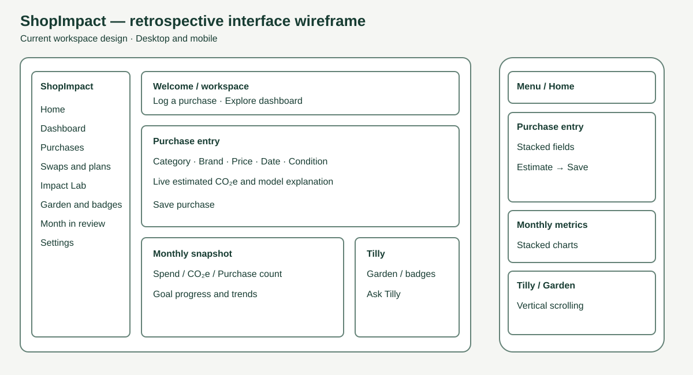

# ShopImpact design plan — assessment scenario 1

This retrospective design record explains how the implemented app addresses the Python Programming summative assessment. It complements the [earlier redesign record](design_plan.md).

## User needs and problem

People see the price of a product immediately but rarely see a comparable environmental estimate. Students making purchase decisions may have limited budgets, little knowledge of emissions and little patience for a complicated form. A first-time user needs a clear entry point and feedback without guilt; a returning user needs trends and control over their saved data; a curious learner needs the assumptions behind the estimate.

| User situation | Need | Design response |
|---|---|---|
| Student comparing a new and used phone | Compare affordability and estimated impact before buying | Swaps, lifespan and keep-versus-replace tools |
| Busy shopper logging a receipt | Quickly record ordinary purchase details | Category tiles, price, brand, condition, date and quick-add |
| Returning user reviewing a month | See what drove totals without interpreting raw records | Dashboard totals, category charts, purchase count and goal progress |
| User concerned about privacy | Explore without an account; control saved records | Direct access, browser-local storage, backups and clear-data controls |
| User sensitive to motion or low contrast | Read comfortably and disable distracting effects | Light/dark appearances, text-size controls and reduced motion |
| Curious student investigating estimates | Distinguish assumptions from scientific evidence | Model explanation, cited research estimates, source panel and validation |

## Wireframe and visual choices

[Open desktop and mobile wireframe](screenshots/shopimpact-wireframe.svg)

The wireframe is a reconstruction of the implemented layout, not a claim that it was drawn before development. Navigation is separated from the working area. Purchase inputs precede the monthly snapshot; the companion graphics sit beside results on wide screens and stack on narrow screens. The home entry action takes priority over research tools. Dark surfaces, mint green and blue accents communicate sustainability and analysis; light mode uses the same visual hierarchy. Labels accompany colors and rewards celebrate recorded choices without implying moral judgment.

## Feature plan and acceptance criteria

| Priority | Feature | Acceptance check |
|---|---|---|
| Compulsory | Product, price and brand inputs | Invalid or incomplete entries are rejected |
| Compulsory | Live price-based CO₂e estimate | Calculation agrees with displayed model factors |
| Compulsory | Monthly spending and estimated impact | Totals agree with the selected month's journal |
| Compulsory | Eco Saver and Low Impact Shopper badges | Rules award only after their thresholds are met |
| Compulsory | Category-specific alternatives | Every category returns an actionable suggestion |
| Compulsory | Turtle graphics | A low-impact choice triggers a sprout; garden and footprint trail visualize recorded progress |
| Optional | Tips and motivational language | Tips rotate and explain choices without shame |
| Optional | Dark/light appearance and accessibility | Both appearances remain readable; animation can be reduced |
| Optional | Journal management and planning | Edit, remove, undo, compare and export entries |
| Research extension | Provenance, model validation, planner and classifier | Methods, limitations and reproducible outputs are inspectable |

## Ethical and practical boundaries

Spend-based estimates are approximate. Brand examples are not certifications, and a low model rating does not prove a purchase is environmentally better. The research model exposes provenance and limits. The assistant receives only consented context; browser storage is not a cloud account. The personal goal is a reflection aid, not a scientific target.

The implementation can be evaluated via the [12-purchase assessment run](ASSESSMENT_TEST_RUN.md), [historical test and improvement log](test_log.md), and [usability review record](USABILITY_FEEDBACK.md).
